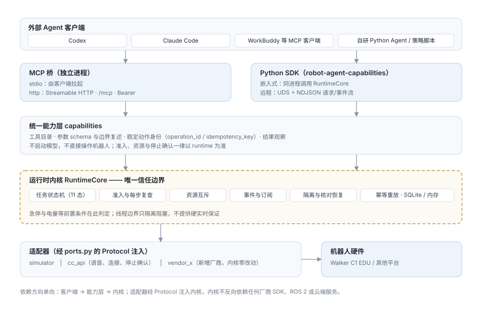

# Robot Agent Runtime & Capabilities

面向 Codex、Claude Code、WorkBuddy 等 MCP 客户端与自研 Python Agent 的机器人能力基础设施。
内核管任务生命周期、资源与事件、取消与恢复；独立能力层提供统一工具目录、参数 schema、
稳定动作身份和结果观察；**Agent 只负责决策**。

<p align="center">
  <a href="assets/architecture.svg"></a>
</p>

<p align="center">
  
  
  
</p>

<p align="center">
  <a href="#快速开始"><strong>快速开始</strong></a> ·
  <a href="#四种接入方式">接入方式</a> ·
  <a href="#五个概念">核心概念</a> ·
  <a href="#设计取舍">设计取舍</a> ·
  <a href="#文档">文档</a> ·
  <a href="#边界与成熟度">边界与成熟度</a>
</p>

> 一句话边界：**runtime 决定「这台机器现在允许做什么」，Agent 决定「要做什么」。**

## 它解决什么问题

写一个能动机器人的 Agent，真正难的不是调接口，而是这三件事每次都要重写：

1. **任务不是一个调用。** 提交、等待、超时、取消、重试、重启后核对——每个 Agent 都会写一遍，
   每个都写得略有不同。
2. **硬件差异会漏进业务代码。** 换一台机器，`if vendor == ...` 就长到业务逻辑里。
3. **安全判定散落各处。** 急停、电量、资源互斥、停止是否确认，一旦分散到每个 Agent，
   就没人能回答「现在到底谁允许它动」。

这个仓库把这三件事收进内核，业务只保留「想做什么」。

## 快速开始

```bash
pip install -e '.[test]'      # Python 3.11+
python examples/embedded_demo.py
```

嵌入式最小用法：

```python
import asyncio

from robot_agent_runtime.adapters.simulator import Simulator
from robot_agent_runtime.models import SkillCall, TaskRequest
from robot_agent_runtime.repositories.memory import InMemoryTaskRepository
from robot_agent_runtime.sdk import RobotRuntime


async def main() -> None:
    runtime = RobotRuntime(InMemoryTaskRepository(), Simulator(delay_s=0.01).skills)
    await runtime.start()
    try:
        final = await runtime.submit_and_wait(TaskRequest(
            task_type="announcement",
            steps=[
                SkillCall(skill="navigation.navigate_to", params={"target": "meeting_room"}),
                SkillCall(skill="audio.speak", params={"message": "The meeting starts at 3 PM."}),
            ],
            idempotency_key="announcement-1",
        ))
        print(final.state)        # TaskState.SUCCEEDED
    finally:
        await runtime.close()


if __name__ == "__main__":
    asyncio.run(main())
```

更多可运行示例见 [examples/README.md](examples/README.md)（嵌入式、远程、前置条件、能力监听、平台事件、CC 语音）。

统一能力客户端提供 `robot.add_task_listener(on_done=...)` 与
`robot.add_platform_listener(on_event=...)`。前者默认自动跟踪本客户端后续 invoke，后者接收
设备事实（包括故障）；on_error 可省略。用完调用 `await robot.close_listeners()` 释放回调资源。
完整示例见 [capability_listeners_demo.py](examples/capability_listeners_demo.py)，
接口与生命周期见 [能力层说明](capabilities/README.md#注册任务和平台监听)。

空闲时的设备变化通过独立的可选平台事件流观察：给 `RobotRuntime` / `RuntimeServer` 配置
`event_source`，再用 `subscribe_platform_events(after_cursor=...)` 回放并接续实时消息。
`PlatformEvent` 先写日志再交付，默认使用有界内存日志；需要重启恢复时显式提供
`SQLitePlatformEventRepository`。平台游标与任务内 `sequence` 分开，事件载荷不参与安全判定。
使用统一能力客户端时，可通过 `RobotCapabilities.subscribe_events(after_cursor=...)` 消费同一
事件流；显式 `sources={'task','platform'}` 可同时观察任务终态与设备事实，指定 task_ids 可补收
快速完成任务。任务序号与平台游标分别恢复；默认平台行为不变，旧任务后端无需增加全局订阅能力。
无硬件示例见 [platform_events_demo.py](examples/platform_events_demo.py)，恢复与网络转发边界见
[SDK 参考](docs/sdk-reference.md#平台事件与通知)。

## 四种接入方式

| 方式 | 适用 | 入口 |
| --- | --- | --- |
| 嵌入式 SDK | 同进程，最短路径 | `RobotRuntime`，见 [SDK 参考](docs/sdk-reference.md) |
| 远程 SDK | 跨进程，UDS + NDJSON | `robot-agent-runtime serve --socket ...` |
| MCP stdio | 客户端拉起的子进程（Codex / Claude Code / WorkBuddy） | `python -m robot_runtime_mcp` |
| MCP HTTP | 跨机接入，或客户端无法管理子进程 | `--mode http --token-env ...`，端点 `/mcp` |

四种方式暴露同一份工具目录与准入语义；HTTP 模式额外要求 Bearer 令牌，默认只监听 `127.0.0.1`。
接入步骤见 [统一接入说明](docs/agent-integration.md)。

## 五个概念

| 概念 | 含义 | 谁负责 |
| --- | --- | --- |
| **技能（Skill）** | 一个可执行能力：输入 schema、占用资源、权限、前置条件、能否取消 | 适配器实现，内核执行 |
| **任务（Task）** | 一到多步技能的顺序执行，11 态状态机，落库可恢复 | 内核 |
| **前置条件** | `estop.clear`、`battery.sufficient` 这类机器条件，提交时与每步执行前各判一次 | 内核 |
| **资源** | 物理互斥单位（`base`、`speaker`）——同一资源上的任务串行 | 内核 |
| **ActionOutcome** | 失败之后「到底动没动」：`executed` 三态 + `stopped` 三态 + `operator_required` | 适配器报告，内核据此决定能否释放资源 |

`ActionOutcome` 是这套设计里最关键的一条：**失败不等于没动**。无法确认静止时，内核在释放
资源锁之前隔离该资源，任务进入 `reconciliation_required`，后续提交被拒——而不是让下一个
任务去撞一台还没停稳的机器。

## 设计取舍

- **唯一信任边界。** 准入、资源、停止确认只在 `RuntimeCore` 里判。上层（MCP 桥、SDK、
  业务 Agent）可以预检、可以解释，但不能替代判定，也不该复制一份。
- **内核零厂商依赖。** 不依赖厂商 SDK、ROS 2 或云端服务；硬件经 `ports.py` 的 Protocol
  注入。换机器不改内核，新增厂商不改内核。
- **失败给事实，不给建议。** 内核返回「执行了多少、是否静止、是否需要人」，不返回
  「建议重试 / 建议改道」。业务含义由业务层解释。
- **能力与业务分离。** 本仓库不授予酒店或导览的业务确认权，也不做跨业务的机器人调度。

## 文档

| 文档 | 内容 |
| --- | --- |
| [架构与模块结构](docs/architecture.md) | 分层、线程归属、模块路径、当前范围 |
| [SDK 与公开 API](docs/sdk-reference.md) | 公开方法、平台事件、通知与 WebSocket 转发、监听执行模式 |
| [生命周期、前置条件与恢复](docs/lifecycle.md) | 状态机、重启核对、降级行为 |
| [技能定义与厂商接入](docs/adapters.md) | `SkillDefinition`、`RobotPlatform`、CC 语音与故障事件 |
| [统一接入说明](docs/agent-integration.md) | 外部 Agent 接入的最短路径 |
| [任务执行与恢复详解](docs/task-execution-and-recovery.md) | 端到端流程、持久化差异、Reconciler 范围 |
| [测试与验证边界](docs/testing.md) | 覆盖了什么，没覆盖什么 |
| [变更记录](CHANGELOG.md) | 行为变化与兼容性 |

子项目：[capabilities/](capabilities/README.md) · [mcp_bridge/](mcp_bridge/README.md) ·
[agent-core/](agent-core/README.md) · [agent/](agent/README.md) ·
[hotel-agent/](hotel-agent/README.md) · [guide-agent/](guide-agent/README.md)

## 边界与成熟度

**已实现**：运行时内核、技能框架、Python SDK（嵌入式 + 远程）、UDS 守护进程、SQLite 持久化、
模拟适配器、厂商接入契约、CC 语音技能、注册式任务监听、有界停止确认与失控资源隔离、
任务总期限、事件分页与有界关闭、独立平台事件日志、全任务实时订阅、可选通知出口和
已连接 WebSocket 的顺序转发。`serve-cc` 启用 CC 故障事件与 SQLite 日志；既有工厂默认不启用事件。

**未实现**：调度器（`priority` 已持久化但不参与排序，无并发上限与抢占）、结构化日志、
自动重规划、回调进程隔离、云端管理平面。

**尚未在真实硬件上验证**：真实模型凭据下的规划质量与动作效果（协议层用本地 HTTP 测试服务验证）；
酒店/导览的导航目标需部署方填入地图数据；未见连接真实麦克风/ASR 或随行检测。
CC 故障载荷结构及初始快照与增量的顺序栅栏尚未验证，当前保留原始载荷，不推断解除或严重度。

**不是功能安全**：线程边界保护内核不被阻塞的 Python 回调拖住，不提供硬实时保证；
真正的急停必须是硬件回路，这里的 `estop.clear` 只做准入判定，不是安全仪表功能。

## 许可

许可证尚未选定。在选定前，代码默认保留所有权利（All rights reserved），
不构成任何形式的使用授权。商业使用前请联系仓库所有者。
