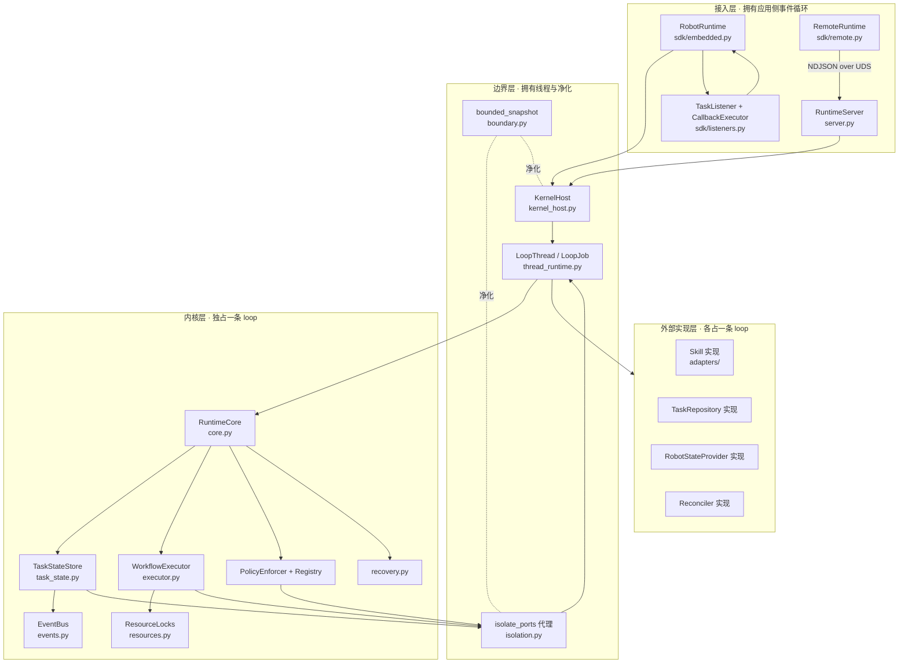
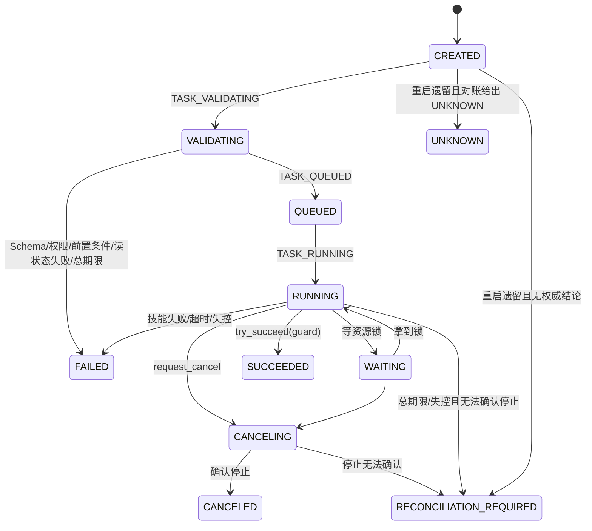
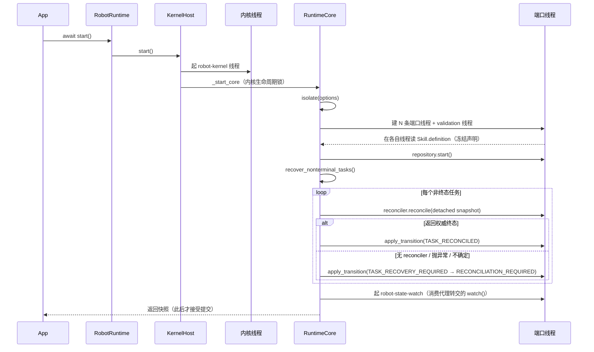
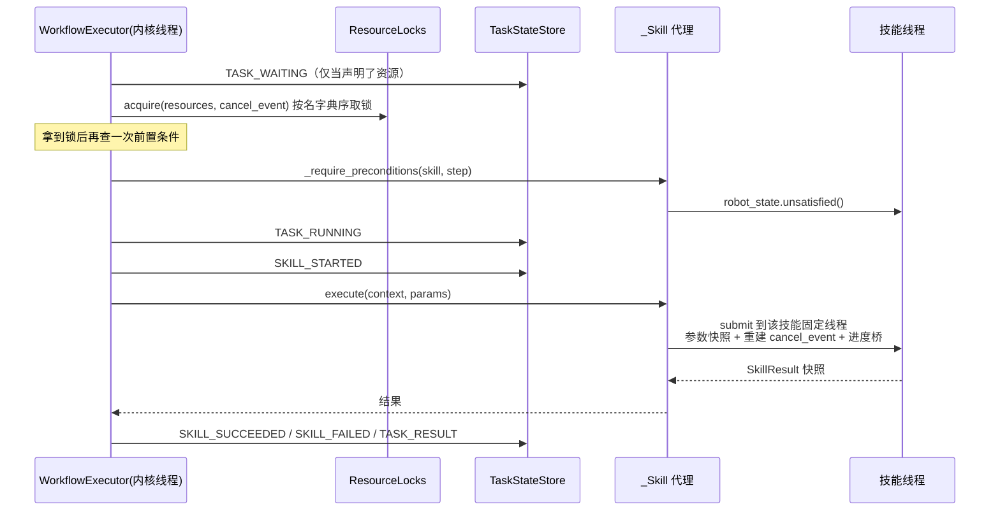
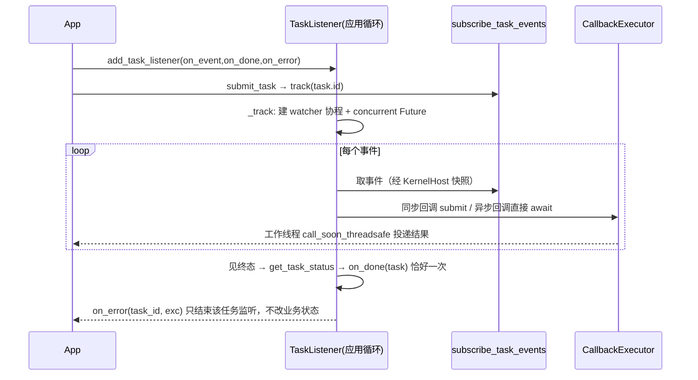

# Robot Agent Runtime 总体设计：主框架与主流程

本文是**代码导读**：把整个项目拆成"分层框架 + 七条主流程 + 四条横切不变量"，每条结论都带
`file:line`，可以点开对照。

与其他文档的分工：

| 文档 | 回答什么 |
| --- | --- |
| `README.md` | 对外契约：怎么调用、API 表、状态机、配置项、当前范围 |
| 本文 | 内部框架：谁拥有什么、一条任务如何流过各个模块、为什么这么切 |
| `docs/task-execution-and-recovery.md` | 端到端叙述：一次语音播报、持久化差异、Reconciler 能做什么 |
| `docs/plans/*.md` | 每次改造的决策记录与验收结果（含被否决的方案） |

> 阅读前提：本文描述的是**当前工作树**（截至 2026-11-04，线程隔离改造已落地但未提交）。
> 若某处与 `git HEAD` 不一致，以工作树为准。

---

## 1. 定位与设计目标

`robot-agent-runtime` 是机器人**本机**任务执行运行时：接收"一串技能调用"构成的任务，
负责准入、资源互斥、超时、取消、状态持久化、事件推送和重启后的状态核对。

四条设计目标决定了整个架构的形状：

1. **内核零领域知识**。运行时不认识"急停""电量""导航"，只做集合求交
   （[ports.py:88-111](file:///Users/zhazha/Documents/robot_core/src/robot_agent_runtime/ports.py#L88-L111)）。
   领域模型全在适配器里。这条决定了内核可以长期不换。
2. **硬件/依赖可替换**。内核不 import 任何厂商 SDK、ROS 2 或云 SDK；外部能力一律实现
   `ports.py` 的 Protocol，靠结构匹配注入，不注册、不继承。
3. **不确定就不重放**。物理动作非幂等，所以"数据库里是 RUNNING"不构成继续执行的理由。
   这条决定了恢复流程、`RECONCILIATION_REQUIRED` 状态和 quarantine 的存在。
4. **内核循环不可被外部代码冻住**。厂商 SDK 里的同步阻塞调用不能拖死状态机。
   这条决定了 2026-11-03 的线程边界改造（本文第 6 节）。

明确**不是**目标的：硬实时保证、功能安全（急停必须靠硬件回路）、进程级故障隔离、
并发调度与抢占、重试。见 [README.md:479-484](file:///Users/zhazha/Documents/robot_core/README.md#L479-L484)。

---

## 2. 主框架

### 2.1 四层



依赖方向严格自上而下：内核层只认 `ports.py` 里的 Protocol，不知道边界层存在——
`KernelHost` 和 `isolate_ports` 是**从外面把内核包起来**的，所以低层 `RuntimeCore`
单独使用时没有隔离（[core.py:88-127](file:///Users/zhazha/Documents/robot_core/src/robot_agent_runtime/core.py#L88-L127)
的 `isolate()` 必须由宿主显式调用）。这一点很重要：**隔离是宿主的属性，不是内核的属性**。

### 2.2 线程拓扑

一个用 `RobotRuntime` + SQLite + 3 个技能 + 状态源 + 对账器的嵌入式进程，长这样：

| 线程 | 谁创建 | 上面跑什么 | 数量 |
| --- | --- | --- | --- |
| 主线程（应用 loop） | 应用 | SDK 门面、`TaskListener` 协程、**异步回调** | 应用自定 |
| `robot-kernel` | `KernelHost` [kernel_host.py:160-164](file:///Users/zhazha/Documents/robot_core/src/robot_agent_runtime/kernel_host.py#L160-L164) | **整个 `RuntimeCore`**：状态机、资源锁、事件总线、`asyncio.Task` | 1 |
| `robot-extension-N` | `IsolatedPorts` [isolation.py:514-519](file:///Users/zhazha/Documents/robot_core/src/robot_agent_runtime/isolation.py#L514-L519) | 该外部对象的**全部方法**（技能 `execute` / 仓储读写 / `watch` / `reconcile`） | 每个唯一对象 1 条 |
| `robot-validation` | `IsolatedPorts` [isolation.py:512-513](file:///Users/zhazha/Documents/robot_core/src/robot_agent_runtime/isolation.py#L512-L513) | jsonschema 准入校验（外部可控的 CPU 工作） | 1 |
| `rar-callback-N` | `CallbackExecutor` [callback_executor.py:84-86](file:///Users/zhazha/Documents/robot_core/src/robot_agent_runtime/sdk/callback_executor.py#L84-L86) | SDK 的**同步**监听回调（惰性创建，daemon） | 最多 4 |

远程模式则在服务端进程重复整套拓扑，客户端只是普通应用线程 + UDS。

三条关键规则：

- **粒度是"对象"不是"类别"**：`IsolatedPorts` 按 `id(obj)` 去重
  （[isolation.py:502-519](file:///Users/zhazha/Documents/robot_core/src/robot_agent_runtime/isolation.py#L502-L519)）。
  同一个 `Skill` 实例注册成两个名字，共用一条线程；两个不同实例各一条。所以**一个卡死的技能
  只冻结它自己和它的别名**，不会冻结别的技能。
- **线程永不替换**：卡住的线程一直占着，不补建
  （[thread_runtime.py:70-77](file:///Users/zhazha/Documents/robot_core/src/robot_agent_runtime/thread_runtime.py#L70-L77)）。
  这是"无法杀死线程"的直接后果，也是当前设计的主要运维代价。
- **上限**：唯一外部对象数 + 1 不得超过 `max_extension_threads`（默认 32，即最多 31 个外部对象），
  超出在构造期直接失败 [isolation.py:504-510](file:///Users/zhazha/Documents/robot_core/src/robot_agent_runtime/isolation.py#L504-L510)。

### 2.3 容量与预留位

每条 `LoopThread` 有两个独立名额：普通名额 `max_pending` 和控制名额 `control_capacity`。
判断依据是 `CONTROL_OPERATION` 这个 `ContextVar`
（[execution_context.py:3](file:///Users/zhazha/Documents/robot_core/src/robot_agent_runtime/execution_context.py#L4)），
在 `_execute` 里按 job 设置，因此**控制属性会沿调用链传到端口线程**
（[thread_runtime.py:200](file:///Users/zhazha/Documents/robot_core/src/robot_agent_runtime/thread_runtime.py#L200)）。

目的只有一个：`get_task_status` / `cancel_task` / 生命周期清理不能被
256 个空闲订阅或一堆慢请求挤出去。三档是**分别记账**的：请求档
`max_pending_calls=256`、控制档 `max_control_calls=16` 在 `_submit_request` 里用两个
`set` 各自限流（[kernel_host.py:294-307](file:///Users/zhazha/Documents/robot_core/src/robot_agent_runtime/kernel_host.py#L294-L307)），
订阅档 `max_subscriptions=256` 按 `self._streams` 数量限流
（[kernel_host.py:358-362](file:///Users/zhazha/Documents/robot_core/src/robot_agent_runtime/kernel_host.py#L358-L362)）。
线程自身的队列容量比这三档更宽：`robot-kernel` 线程的普通名额是
`max_pending_calls + max_subscriptions`，控制名额是 `max_control_calls + 3`
（[kernel_host.py:160-164](file:///Users/zhazha/Documents/robot_core/src/robot_agent_runtime/kernel_host.py#L160-L164)），
`robot-validation` 与每条 `robot-extension-N` 同样多给 3 个控制位兜底
（[isolation.py:512-518](file:///Users/zhazha/Documents/robot_core/src/robot_agent_runtime/isolation.py#L512-L518)、
理由写在 [isolation.py:490-491](file:///Users/zhazha/Documents/robot_core/src/robot_agent_runtime/isolation.py#L490-L491)）。
这 3 个位子专门留给"公开查询正在等外部代码时"仍要能挤进去的清理调用（如 `iterator.aclose()`）。
容量耗尽统一报 `EXTENSION_CAPACITY_EXCEEDED`。

### 2.4 文件清单

| 文件 | LOC | 一句话职责 |
| --- | --- | --- |
| `models.py` | 116 | 7 个 pydantic 模型 + `TaskState` 枚举 + `SkillContext` dataclass |
| `errors.py` | 118 | 每个失败模式一个异常子类 + 一个 `code` 字符串 |
| `ports.py` | 153 | 6 个 Protocol：`Skill` / `TaskRepository` / `PagedEventRepository` / `Reconciler` / `RobotStateProvider` / `CallbackRobotApi` |
| `core.py` | 446 | 生命周期、公开 API、提交准入、状态源打断 |
| `task_state.py` | 236 | **状态唯一写入点** + 本机任务归属（6 个按 task id 的字典） |
| `executor.py` | 350 | 单任务步骤编排：锁资源 → 检查前置条件 → 带期限执行 → 恰好一次终态 |
| `resources.py` | 84 | 按声明的资源互斥锁 + 失控资源隔离 |
| `events.py` | 132 | 历史回放 + 实时推送 + watermark 去重 + 溢出报告 |
| `policy.py` | 85 | Schema 校验、权限 allowlist、前置条件求交 |
| `recovery.py` | 84 | 重启时对每个非终态任务求权威终态 |
| `repository.py` / `sqlite_repository.py` | 134 / 348 | 两种持久化，语义等价 |
| `wire.py` | 57 | NDJSON 成帧，1 MiB 上限 |
| `server.py` | 287 | UDS 守护进程：请求分发 + 订阅流 |
| `kernel_host.py` | 399 | 内核线程托管 + 请求/事件跨线程交接 + 有序关闭 |
| `thread_runtime.py` | 269 | `LoopThread` / `LoopJob`：固定 daemon 循环、容量、真实完成 |
| `isolation.py` | 575 | 6 类端口的代理：线程归属、期限、取消/进度桥接、故障关闭 |
| `boundary.py` | 151 | 有界快照：计量后构建，拒绝外部对象钩子 |
| `options.py` | 39 | `RuntimeOptions` 10 个限额 |
| `execution_context.py` | 4 | 控制操作 `ContextVar` |
| `sdk/embedded.py` / `remote.py` | 89 / 257 | 两种同签名门面 |
| `sdk/listeners.py` / `callback_executor.py` | 283 / 212 | 统一注册监听 + 同步回调的有界线程池 |
| `adapters/simulator.py` / `cc_api.py` | 373 / 420 | 无硬件自测实现 + CC API 语音适配器 |

### 2.5 打包与依赖

`pyproject.toml`：包名 `robot-agent-runtime` v0.1.0，`requires-python >= 3.11`，src 布局 + `py.typed`，
控制台入口 `robot-agent-runtime = robot_agent_runtime.__main__:main`。

**运行时依赖只有三个**：`pydantic>=2`、`jsonschema>=4`（`policy.py` 用）、`aiosqlite>=0.20`
（`sqlite_repository.py` 用）。测试依赖 `pytest>=8` + `pytest-asyncio>=0.24`（`asyncio_mode=auto`）。

厂商包 `ubt_robot` **不在依赖里**——`adapters/cc_api.py` 只依赖 `ports.py` 的
`CallbackRobotApi` 结构契约，所以宿主上常规导入不需要它（[ports.py:128-153](file:///Users/zhazha/Documents/robot_core/src/robot_agent_runtime/ports.py#L128-L153)）。
AGENTS.md 的"不加依赖"是硬约束：宿主 pip 装不上东西，加一个依赖就等于让所有人只能进容器干活。

---

## 3. 数据模型与状态机

### 3.1 模型

```
TaskRequest(task_type, steps[SkillCall], priority, timeout_s, idempotency_key, metadata)
  └─ 落库为 → Task(id, task_type, state, steps, current_step, priority, timeout_s,
                   idempotency_key, metadata, result, error, cancel_requested,
                   created_at, updated_at)
SkillCall(skill, params, timeout_s?)        一步
SkillDefinition(name, version, input_schema, resources, permissions,
                preconditions, timeout_s, supports_cancel)   技能的全部契约
SkillContext(task_id, execution_id, cancel_event, progress)  内核交给技能的唯一对象
SkillResult(success, output, error)
Event(event_id, task_id, sequence, event_type, timestamp, data)
```

要点：

- **`SkillDefinition` 是声明式的**，校验/加锁/超时/取消全由运行时按声明统一执行，技能实现里
  不许自己做（AGENTS.md 不变量 6）。
- `TaskRequest.timeout_s` 现在是**总期限**，从接受请求那一刻起算，覆盖准入、排队、等资源、执行
  （[core.py:317-318](file:///Users/zhazha/Documents/robot_core/src/robot_agent_runtime/core.py#L317-L318)）。
- `SkillContext` 里的 `cancel_event` 是内核的 `asyncio.Event`，但技能在线程隔离下拿到的
  是代理**在自己线程里重建**的等价 event（[isolation.py:396-418](file:///Users/zhazha/Documents/robot_core/src/robot_agent_runtime/isolation.py#L396-L418)），
  绝不跨线程共享 asyncio 对象。
- 全部时间戳强制 timezone-aware UTC（`_as_utc` → `UTCDateTime`，[models.py:70-76](file:///Users/zhazha/Documents/robot_core/src/robot_agent_runtime/models.py#L70-L76)）。
  技能进度**不是** `Task` 的字段，只以 `SKILL_PROGRESS` 事件形式存在——状态里没有可被覆盖的
  progress，就不存在"进度写入和状态机抢同一个字段"的问题。

### 3.2 状态机



终态：`SUCCEEDED / FAILED / CANCELED / UNKNOWN / RECONCILIATION_REQUIRED`
（[models.py:24-32](file:///Users/zhazha/Documents/robot_core/src/robot_agent_runtime/models.py#L24-L32)）。

`RECONCILIATION_REQUIRED` 有**两个来源**，语义相同（"软件结束不等于物理停止，需要权威结论"）：

1. 重启遗留：`recovery.py` 拿不到权威终态（[recovery.py:34-47](file:///Users/zhazha/Documents/robot_core/src/robot_agent_runtime/recovery.py#L34-L47)）；
2. 运行中失控：取消/超时后停止确认期内没结束（[executor.py:168-176](file:///Users/zhazha/Documents/robot_core/src/robot_agent_runtime/executor.py#L168-L176)）。

---

## 4. 端口契约：外部要实现什么

| Protocol | 方法 | 谁调用 | 失败语义 |
| --- | --- | --- | --- |
| `Skill` | `definition` / `async execute(context, params)` | `WorkflowExecutor` | 超时/取消不确定 → 该实例永久 poisoned |
| `TaskRepository` | `start/close/create_task/get_task/update_task/append_event/apply_transition/list_events/get_nonterminal_tasks/find_by_idempotency_key` | `TaskStateStore`、`EventBus`、`RuntimeCore` | 任一超时 → 整个仓储 poisoned |
| `PagedEventRepository` | `+ list_events_page(task_id, after, limit)` | `EventBus.history` | 可选；没有则代理在工作线程裁页兼容 |
| `Reconciler` | `async reconcile(task) -> TaskState \| None` | `recovery.py`（仅 `start()`） | 异常/不确定 → `RECONCILIATION_REQUIRED` |
| `RobotStateProvider` | `async unsatisfied()` / `watch()` | `PolicyEnforcer`、`WorkflowExecutor`、`core._watch_robot_state` | 读失败 → 提交 `INTERNAL_ERROR`（失败关闭） |
| `CallbackRobotApi` | `request/notify/add_service/remove_service/set_disconnect_callback` | `adapters/cc_api.py` | 厂商回调可能在 SDK 自有线程 |

定义见 [ports.py:14-153](file:///Users/zhazha/Documents/robot_core/src/robot_agent_runtime/ports.py#L14-L153)。
每个 Protocol 的 docstring 都写了宿主语义（在线程隔离下谁拥有它、什么算不确定），
这些 docstring 是本项目最主要的"契约文档"，比 README 更精确。

新端口必须配 `test_contracts.py` 里的契约测试，让后续真实适配器可复用。

---

## 5. 主流程

### 流程 1：启动与重启恢复



关键点：

- **先恢复，后接受新任务**：`_start_core` 持内核生命周期锁，`start()` 没完成时
  `_require_running()` 会拒绝（[core.py:444-446](file:///Users/zhazha/Documents/robot_core/src/robot_agent_runtime/core.py#L444-L446)）。
- 恢复写事件时任务**没有本机归属**，所以用 `recovery_ownership()` 临时只挂锁和序号，
  并且把序号**接着重启前继续**（[task_state.py:48-64](file:///Users/zhazha/Documents/robot_core/src/robot_agent_runtime/task_state.py#L48-L64)）——
  否则事件序号会撞车。
- 技能声明在启动阶段就被冻结成快照，之后准入校验不再触碰外部对象的可变状态。
- 这条流程是**不重放**的实现处（AGENTS.md 不变量 2）。

### 流程 2：提交任务（准入）

`core.py:316-397`。顺序是有意为之的：

1. `submit_task` 先用**内核循环的单调时钟**算出总期限 `deadline`（[:317-318](file:///Users/zhazha/Documents/robot_core/src/robot_agent_runtime/core.py#L317-L318)），
   然后 `_submit_owned` 包在 `asyncio.shield` 里——**调用方取消不能把已登记的任务变成孤儿**，
   必须等本机归属登记完才允许逃逸（[:319-328](file:///Users/zhazha/Documents/robot_core/src/robot_agent_runtime/core.py#L319-L328)）。
2. `idempotency_lock` 内查幂等键，命中直接返回既有任务；否则建 `Task`、`create_task` 落库、
   `register()` 登记本机归属（[:331-350](file:///Users/zhazha/Documents/robot_core/src/robot_agent_runtime/core.py#L331-L350)）。
3. 依次发 `TASK_CREATED`、`TASK_VALIDATING`。
4. 取一次 `unsatisfied()` 快照，**整单所有步骤共用这一份读数**（[:363](file:///Users/zhazha/Documents/robot_core/src/robot_agent_runtime/core.py#L363)），
   然后逐步 `validate`。隔离模式下校验被派到 `robot-validation` 线程（[:368](file:///Users/zhazha/Documents/robot_core/src/robot_agent_runtime/core.py#L368)、
   [isolation.py:546-565](file:///Users/zhazha/Documents/robot_core/src/robot_agent_runtime/isolation.py#L546-L565)）。
5. 任何 `AgentRuntimeError` → 落 `FAILED` 并 `cleanup()`，**返回任务而不是抛异常**（[:379-390](file:///Users/zhazha/Documents/robot_core/src/robot_agent_runtime/core.py#L379-L390)）。
   这是"校验失败也是一次合法的任务生命周期"的体现。
6. 通过则发 `TASK_QUEUED`，`create_task(executor.run(task, deadline))` 并登记执行句柄。
   **`submit_task` 不等执行**——它返回的是 `QUEUED` 快照。

注意：`priority` 落库了但**不参与排序**，也没有并发上限，提交即起协程。调度器还没做。

### 流程 3：单步执行

`executor.py:49-224`，每一步的内层顺序是这套运行时最讲究的一段：



为什么"拿锁之后、发 `SKILL_STARTED` 之前"才读机器人状态
（[executor.py:86-92](file:///Users/zhazha/Documents/robot_core/src/robot_agent_runtime/executor.py#L86-L92)）：
拿锁前的读数可能已经过期，而 `SKILL_STARTED` 一旦发布就宣称这一步真的开始了——
一个即将被拒的步骤不能先发开始事件。这条顺序是测试写死的。

`ResourceLocks` 按资源名**字典序**取锁（避免死锁），等锁期间可被 `cancel_event` 打断，
`finally` 里把已获得的锁逆序全部释放（[resources.py:44-84](file:///Users/zhazha/Documents/robot_core/src/robot_agent_runtime/resources.py#L44-L84)）。

### 流程 4：取消、超时与"停止确认"

这是整个项目最容易被误读的部分。**三层，每层都不能证明物理停止**：

```
第 1 层  cancel_event.set()           协作信号，技能自己轮询/等待
第 2 层  task.cancel()                仅当 supports_cancel=True
第 3 层  停止确认期 cancel_grace_s     等真实结束（默认 0.2s，可再来一轮）
```

- `cancel_task`：取本机任务 → `request_cancel`（发 `TASK_CANCEL_REQUESTED`，置状态 `CANCELING`）
  → `cancel_event.set()` → **释放生命周期锁后**才 `await shield(execution)`
  （[core.py:413-437](file:///Users/zhazha/Documents/robot_core/src/robot_agent_runtime/core.py#L413-L437)）。
  锁内不做等待，否则取消会把整个内核的提交路径堵死。
- `executor._confirm_stop`：等 `cancel_grace_s`；没结束且 `supports_cancel` 才 `task.cancel()` 再等一轮。
  判定标准是"**任务真的结束且结果可信**"：`TaskCancelled` 或 `SkillResult.success` 才算确认；
  协程 `CancelledError`、任何异常、返回失败结果都算不确定 → `ExecutionUnresponsive`
  （[executor.py:300-328](file:///Users/zhazha/Documents/robot_core/src/robot_agent_runtime/executor.py#L300-L328)）。
- 上面还叠了一层：`_Skill` 代理自己也有 `_CancelBridge` + `_poisoned`，
  确认不了就**永久拒绝该技能实例**（[isolation.py:452-481](file:///Users/zhazha/Documents/robot_core/src/robot_agent_runtime/isolation.py#L452-L481)）。
- 后果链：`ExecutionUnresponsive` → `resources.quarantine(声明的资源)` →
  任务落 `RECONCILIATION_REQUIRED` → 迟到结果不得把任务改回成功，终态后不再收进度。
- **隔离永不自动解除**（[resources.py:23-37](file:///Users/zhazha/Documents/robot_core/src/robot_agent_runtime/resources.py#L23-L37)）。
  后续等待者拿到锁后还会**再查一次**隔离表（`resources.py` 里 yield 前的 `_require_available`），
  所以"软件任务结束了"绝不等于"硬件可以复用了"。

总期限到期走同一套：未派发或已确认停止 → `FAILED / TASK_TIMEOUT`；
停止不明 → 待对账（[executor.py:160-176](file:///Users/zhazha/Documents/robot_core/src/robot_agent_runtime/executor.py#L160-L176)）。

### 流程 5：事件订阅与回放

`events.py` + `kernel_host.py` 两段，合起来保证"先历史后实时、顺序单调、不重不漏或明确报错"。

**EventBus（内核线程内）**

- `subscribe(task_id, after_sequence)` **先注册队列，再回放历史**
  （[events.py:68-84](file:///Users/zhazha/Documents/robot_core/src/robot_agent_runtime/events.py#L68-L84)）。
  注册必须在前，否则读库期间发布的事件会丢。
- 回放和实时共用一个 `watermark`：历史里已交付的最大 `sequence`，
  实时队列里 `sequence <= watermark` 的一律丢弃（[:80-107](file:///Users/zhazha/Documents/robot_core/src/robot_agent_runtime/events.py#L80-L107)）。
  这就是"先回放后实时"的去重机制。
- 历史按 `list_events_page` 分页（默认 128），旧仓储退化为 `list_events` 后切片；
  页内出现 `sequence <= watermark` 直接 `INTERNAL_ERROR`（仓储返回乱序历史是 bug，不是降级点），
  每页之间 `await asyncio.sleep(0)` 让出循环，避免长历史独占内核
  （[events.py:53-66](file:///Users/zhazha/Documents/robot_core/src/robot_agent_runtime/events.py#L53-L66)）。
- `publish` 检查每个订阅队列，超过 `max_event_buffer`（默认 1000）就**清空该队列并塞进一个
  `EventStreamOverflow` 异常对象**，附带"我最后交付到第几号"，调用方可以据此重放（[:23-51](file:///Users/zhazha/Documents/robot_core/src/robot_agent_runtime/events.py#L23-L51)）。
  已经溢出的队列进入 `_overflowed` 集合，之后不再往里投递，避免反复清空。
  溢出只影响这一个订阅者，不影响别的订阅者，也不影响任务本身。
  这两个容量默认值写在 `EventBus.__init__`，`RuntimeOptions` 的值是
  `RuntimeCore.isolate()` 里**直接赋值覆盖私有属性**进去的（[core.py:120-122](file:///Users/zhazha/Documents/robot_core/src/robot_agent_runtime/core.py#L120-L122)）——
  改 `EventBus` 字段名要记得同步这里。
- 看到终态事件就 return；`close()` 广播 `None` 哨兵，且哨兵排在所有已发布事件之后。

**KernelHost（跨线程）**

内核事件不能直接递到应用线程，所以是**逐项拉取**：

- 应用侧的 async generator 每次 `offline_next()` 取不到就向内核线程 `submit(stream.pull)`，
  `pull` 在内核线程 `anext` 源生成器并做**快照**，然后交给等待方（[kernel_host.py:95-108](file:///Users/zhazha/Documents/robot_core/src/robot_agent_runtime/kernel_host.py#L95-L108)、[:363-386](file:///Users/zhazha/Documents/robot_core/src/robot_agent_runtime/kernel_host.py#L363-L386)）。
- 关闭时 `_drain_streams` 把每个流剩余事件收进**有界缓冲**（`max_event_buffer`），
  缓冲没排空就溢出，同样带 watermark（[kernel_host.py:110-133](file:///Users/zhazha/Documents/robot_core/src/robot_agent_runtime/kernel_host.py#L110-L133)）。
  这样"内核停了但客户端还没被唤醒"的窗口里的事件不丢。

### 流程 6：SDK 统一任务监听

`add_task_listener` 是**注册式**的：只观察本 SDK 实例注册之后提交的任务，不扫历史、
不收别的 SDK 实例的任务。



要点（[listeners.py:30-222](file:///Users/zhazha/Documents/robot_core/src/robot_agent_runtime/sdk/listeners.py#L30-L222)）：

- **每个任务一个协程**，慢回调只拖住那个任务；`_track` 里对同一 task id 去重，幂等重复提交不会重复通知。
- 异步回调留在调用方循环（可协作取消）；**普通函数交给 `CallbackExecutor`**：惰性创建
  `rar-callback-{index}` 守护线程，4 个工作线程、64 个排队名额、5 秒排队期限，不可配置
  （[callback_executor.py:49-51](file:///Users/zhazha/Documents/robot_core/src/robot_agent_runtime/sdk/callback_executor.py#L49-L51)、
  [:84-86](file:///Users/zhazha/Documents/robot_core/src/robot_agent_runtime/sdk/callback_executor.py#L84-L86)）。
  `submit/cancel/close` 只在调用方循环上操作 Future 与定时器，工作线程只用
  `call_soon_threadsafe` 投递结果——所以它没有 `ThreadPoolExecutor` 的退出钩子和私有字段依赖。
- 队列满 → `LISTENER_CALLBACK_QUEUE_FULL`，排队过期 → `LISTENER_CALLBACK_TIMEOUT`；
  两者都只结束该任务监听，业务任务照跑。**已被线程认领的回调不可打断**：
  `cancel` 把它标成 abandoned 并清空 callback/args/result，完成后走 `discard_result`
  遗弃（对协程调 `close()` 并吞掉清理异常，以免杀死工作线程）
  （[callback_executor.py:90-115](file:///Users/zhazha/Documents/robot_core/src/robot_agent_runtime/sdk/callback_executor.py#L90-L115)、
  [:206-212](file:///Users/zhazha/Documents/robot_core/src/robot_agent_runtime/sdk/callback_executor.py#L206-L212)）。
- `wait()` 只 join 调用时已登记的任务；`close()` 取消**未被领取**的排队回调，
  **遗弃在途回调的结果**（不宣称副作用已停止）。所以要看最终回调必须先 `wait()` 再 `close()`。
- `wait()` 等的是 `concurrent.futures.Future` 而非 watcher 协程，这样取消 `wait()` 不会误取消后台监听。

### 流程 7：远程模式（UDS）

- **一个请求一条连接**：`_request` 打开 → 写一帧 → 读一帧 → 关闭
  （[remote.py:160-206](file:///Users/zhazha/Documents/robot_core/src/robot_agent_runtime/sdk/remote.py#L160-L206)）。
  没有连接池，也没有请求超时；`start()` 只做一次 `health`。
- **订阅是一条长连接**：客户端发 `subscribe_task_events`，服务端持续写
  `{type:"event"}`，历史放完后发 `{type:"done"}`。
- 服务端检测客户端离开的方式很巧：`reader.read(1)` 与事件迭代器竞速，
  读到东西（EOF 或任何字节）就取消订阅并清理（[server.py:254-264](file:///Users/zhazha/Documents/robot_core/src/robot_agent_runtime/server.py#L254-L264)）。
- 帧格式：NDJSON，单条上限 **1 MiB**（[wire.py:9-40](file:///Users/zhazha/Documents/robot_core/src/robot_agent_runtime/wire.py#L9-L40)）；
  方法集 `health / submit_task / get_task_status / cancel_task / list_skills / subscribe_task_events`
  （[server.py:211-228](file:///Users/zhazha/Documents/robot_core/src/robot_agent_runtime/server.py#L211-L228)）。
- 服务端把 `AgentRuntimeError` 转成 `{ok:false, error:{code,message,details}}`
  （[server.py:192-203](file:///Users/zhazha/Documents/robot_core/src/robot_agent_runtime/server.py#L192-L203)），
  客户端统一还原成 `RemoteRuntimeError(code=...)`（[remote.py:243-257](file:///Users/zhazha/Documents/robot_core/src/robot_agent_runtime/sdk/remote.py#L243-L257)）。
  **代价**：远程拿不到类型化异常，只能按 `code` 字符串分支——这是目前"两形态 API 一致"这条
  承诺上唯一的破口。
- 服务端自己也是 `KernelHost` 的宿主（[server.py:26-35](file:///Users/zhazha/Documents/robot_core/src/robot_agent_runtime/server.py#L26-L35)），
  所以远程模式下内核同样独占线程；`RemoteRuntime(options=...)` 只用到本地 `cancel_grace_s`。

---

## 6. 横切机制（四条不能改坏的不变量）

### 6.1 状态唯一写入点：`TaskStateStore.transition()`

[task_state.py:95-133](file:///Users/zhazha/Documents/robot_core/src/robot_agent_runtime/task_state.py#L95-L133)。
一次转换固定四步，顺序不可变：

```
持该任务的 asyncio.Lock
  → 深拷贝活任务为快照，套用 changes
  → apply_transition(快照, 事件)   ← 快照与事件在一次仓储调用里原子写入
  → adopt_snapshot(活任务, 权威返回值)  ← 用仓储回填的值，不是用自己算的值
  → 最后才 events.publish(事件)
```

三个设计后果值得记住：

- **`sequences[task_id]` 只在这里 ++**，所以事件序号单调（AGENTS.md 不变量 7）。
- **权威值来自仓储**：`InMemory` 做深拷贝（`model_validate_json` 往返），
  `SQLite` 用 `UPDATE` 后重新读；因此活对象不会带着一个"内存觉得成功但库里没落"的状态。
- **发布在写之后**：订阅者永远不会看到一个库里还不存在的状态。

所有带 guard 的转换（`execution_transition` / `try_succeed` / `request_cancel`）共用同一把锁，
所以"取消"和"推进成功"是**公平竞速**，不存在已取消任务又被推进成功的窗口
（[task_state.py:135-169](file:///Users/zhazha/Documents/robot_core/src/robot_agent_runtime/task_state.py#L135-L169)）。
`WorkflowExecutor` 自身无状态，只做顺序和"恰好一次终态"映射。

进度上报是**例外路径**：每次 `progress(v)` 起一个后台 `transition` 协程，不阻塞技能；
步骤结束/失败/终态前用 `drain_progress` 收干，终态后靠 guard 拒绝，
关闭时靠 `_shutting_down` 丢弃（[task_state.py:180-216](file:///Users/zhazha/Documents/robot_core/src/robot_agent_runtime/task_state.py#L180-L216)）。

### 6.2 原子持久化：两种实现，同一种语义

| | `InMemoryTaskRepository` | `SQLiteTaskRepository` |
| --- | --- | --- |
| `apply_transition` | 先记旧值，写失败**手工回滚两份字典**（[repository.py:61-82](file:///Users/zhazha/Documents/robot_core/src/robot_agent_runtime/repository.py#L61-L82)） | `BEGIN` + `UPDATE tasks` + `INSERT events` + `COMMIT`，异常 `ROLLBACK`（[sqlite_repository.py:174-215](file:///Users/zhazha/Documents/robot_core/src/robot_agent_runtime/sqlite_repository.py#L174-L215)） |
| 表/索引 | — | `tasks(id PK, idempotency_key, is_terminal, created_at, payload)` + 幂等键**部分唯一索引**；`events(event_id, task_id, sequence CHECK>0, payload)` + `UNIQUE(task_id, sequence)`（[sqlite_repository.py:26-46](file:///Users/zhazha/Documents/robot_core/src/robot_agent_runtime/sqlite_repository.py#L26-L46)） |
| 并发 | 单事件循环，无锁 | **一条连接 + `asyncio.Lock` 串行化所有操作**；没设 WAL、没设 busy_timeout |
| 投影列的意义 | — | `is_terminal` 让 `get_nonterminal_tasks()` 不用解 payload；冲突靠唯一约束而不是先查后写 |

值得注意：`SQLite` 没有开 WAL。单连接串行化下这是安全的，但**外部进程直接读同一个库文件**
时看不到未提交内容，而且写并发全压在这把 Python 锁上。这条限制了"云端管理平面直接读 DB"的设想。

### 6.3 边界净化：`bounded_snapshot`

[boundary.py:21-151](file:///Users/zhazha/Documents/robot_core/src/robot_agent_runtime/boundary.py#L21-L151)。
所有跨线程数据都过它，两趟：**先只计量不构建**，再构建。

- 计费口径是紧凑 JSON 的字节数（含 UTF-8 多字节与转义），默认 1 MiB / 深度 64，超限提前抛
  `SnapshotTooLarge`，**不先复制再检查**。
- 只用内建遍历（`dict.__getitem__`、`str.__iter__`、`object.__getattribute__`），
  因此外部对象的 `__deepcopy__` / `__iter__` / `__repr__` **没有机会在内核线程上运行**。
- 允许的类型：JSON 标量、`list/tuple/set/frozenset/dict`、`datetime`（tzinfo 必须是裸
  `timezone`）、以及 7 个规范模型（重建为基类，子类降级成普通容器）。引用环直接拒绝。
- 异常也净化：丢弃外部 traceback 与异常链，按类名映射回 `errors.py` 里的类型，
  非 `AgentRuntimeError` 统一压成 `InternalError("Extension operation failed")`
  （[isolation.py:44-87](file:///Users/zhazha/Documents/robot_core/src/robot_agent_runtime/isolation.py#L44-L87)）。

`_Port.call` 的完整路径值得看一眼（[isolation.py:124-166](file:///Users/zhazha/Documents/robot_core/src/robot_agent_runtime/isolation.py#L124-L166)）：
参数先快照 → 提交到该对象的固定线程 → `job.wait(port_timeout_s)` →
结果 `_unwrap`（把 `_Failure` 还原成本地抛出的干净异常）。
**写操作**超时后不认账：它 `shield` 住真实完成的 job，一直等到真实结束或总 deadline，
因为"超时"不等于"没提交"。

### 6.4 请求 / 真实完成分离：`LoopJob`

[thread_runtime.py:32-67](file:///Users/zhazha/Documents/robot_core/src/robot_agent_runtime/thread_runtime.py#L32-L67)。
`LoopJob` 的完成 Future 属于**真实调用**，等待方超时/取消都改不了它：

- `wait()` 内部 `wrap_future` + `shield`，所以取消等待方不会取消远端工作。
- `cancel()` **只是请求**：还没开始的工作可以立刻取消；已开始且 `cancellable=False`
  （未声明 `supports_cancel` 的技能）直接忽略请求。
- `started()` / `done()` / `result()` 让上层能区分"我放弃等待"和"它真的停了"。

这条是整个"不谎报停止"语义的地基。所有需要"必须等到真实结束"的地方都是同一个写法：
`while not done: await asyncio.shield(task)`（吞掉取消继续等），
出现在 [isolation.py:151-159](file:///Users/zhazha/Documents/robot_core/src/robot_agent_runtime/isolation.py#L151-L159)、
[:445-450](file:///Users/zhazha/Documents/robot_core/src/robot_agent_runtime/isolation.py#L445-L450)、
[executor.py:281-287](file:///Users/zhazha/Documents/robot_core/src/robot_agent_runtime/executor.py#L281-L287)。
读代码时看到这种"怪写法"不要顺手改掉——那是防取消穿透的。

---

## 7. 失败关闭矩阵

"读不到机器人不等于机器人可用"这条原则贯穿全部失败路径：

| 失败点 | 上报 | 对当前任务 | 对后续 | 是否永久 |
| --- | --- | --- | --- | --- |
| `unsatisfied()` 抛错/超时 | `INTERNAL_ERROR` | 提交失败 | 无 | 否 |
| `reconcile()` 抛错/不确定/超时 | `RECONCILIATION_REQUIRED` | 落待对账 | 无 | 否 |
| 仓储任一操作超时 | `EXTENSION_TIMEOUT` | 终态可能没落盘 | 该仓储拒绝一切后续操作 | **是** |
| 技能执行超时且未确认停止 | `EXECUTION_UNRESPONSIVE` | `RECONCILIATION_REQUIRED` | 该技能实例 + 其资源隔离 | **是** |
| 技能吞掉取消 | 同上 | 同上 | 同上 | **是** |
| 技能返回非法值/超预算快照 | `INTERNAL_ERROR` / `SNAPSHOT_TOO_LARGE` | 失败 | 无（实例保留线程） | 否 |
| 端口线程名额耗尽 | `EXTENSION_CAPACITY_EXCEEDED` | 拒绝 | 需腾出容量 | 否 |
| 事件订阅队列溢出 | `EVENT_STREAM_OVERFLOW`（带 watermark） | 不影响 | 调用方按序号重放 | 否 |
| 同步监听队列满/排队过期 | `LISTENER_CALLBACK_QUEUE_FULL` / `_TIMEOUT` | 不影响业务任务 | 该任务监听结束 | 否 |
| 适配器停止未确认（CC API） | `ROBOT_STOP_UNCONFIRMED` → `EXECUTION_UNRESPONSIVE` | `RECONCILIATION_REQUIRED` | `speaker` 资源隔离 | **是** |

**唯一的恢复出口是重启进程**（重启后再走流程 1 的对账）。当前既没有诊断 API，也没有
"人工确认硬件已停"后的显式解除入口——这是已知的最大运维缺口。

---

## 8. 配置：`RuntimeOptions`

10 个字段，全部构造期校验（拒绝 `bool`、非有限、非正数）
（[options.py:7-39](file:///Users/zhazha/Documents/robot_core/src/robot_agent_runtime/options.py#L7-L39)）：

| 字段 | 默认 | 管什么 | 设小了会怎样 |
| --- | --- | --- | --- |
| `port_timeout_s` | 5.0 | 任一端口的**单次**操作期限 | 慢一点的磁盘/网络就触发毒化 |
| `cancel_grace_s` | 0.2 | 停止确认窗口；技能/监听清理都用它 | 真实硬件停稳慢 → 大量误判待对账 + 隔离 |
| `max_extension_threads` | 32 | 外部对象数 + 1 的上限 | 技能装不下，构造期就失败 |
| `max_pending_calls` | 256 | 普通请求并发 | 正常提交被 `EXTENSION_CAPACITY_EXCEEDED` |
| `max_control_calls` | 16 | 查询/取消/生命周期并发 | 查状态会失败 |
| `max_subscriptions` | 256 | 同时活动的事件订阅 | 订阅报错 |
| `max_snapshot_bytes` | 1 MiB | 单个跨边界值 | 大输出/大参数直接 `SNAPSHOT_TOO_LARGE` |
| `max_snapshot_depth` | 64 | 嵌套深度 | 深层结构被拒 |
| `event_page_size` | 128 | 历史回放每页 | 只是往返次数变多 |
| `max_event_buffer` | 1000 | 实时队列 + 关闭缓冲 | 慢订阅者更容易溢出 |

`cancel_grace_s` 与 `port_timeout_s` 是两个**语义上属于每个端口/每个技能**的值，现在被做成全局，
这是配置模型里最别扭的地方（导航要 2s，TTS 只要 0.05s）。

---

## 9. 适配器层现状

`adapters/` 是 `ports.py` 的两组参考实现，也是**唯一**内核之外的领域知识所在地。

### `simulator.py`（无硬件自测）

- `SimulatedSkill` 为基类，`Simulator` 注册四个技能（[simulator.py:350-373](file:///Users/zhazha/Documents/robot_core/src/robot_agent_runtime/adapters/simulator.py#L350-L373)），
  共享同一个 `state` 字典（`position` / `last_message` / `navigation_count` / `speech_count`）：

  | 技能名 | resources | permissions | preconditions | supports_cancel |
  | --- | --- | --- | --- | --- |
  | `navigation.navigate_to` | `{base}` | `{navigation}` | `{estop.clear, battery.sufficient}` | True |
  | `audio.speak` | `{speaker}` | `{audio}` | 空 | True |
  | `robot.get_state` | 空 | 空 | 空 | **False** |
  | `wait.delay` | 空 | 空 | 空 | True |

  `timeout_s` 一律用默认 30；取消用 `asyncio.wait` 与 `cancel_event` 竞速
  （[simulator.py:65-83](file:///Users/zhazha/Documents/robot_core/src/robot_agent_runtime/adapters/simulator.py#L65-L83)）。
  故障注入靠 `Simulator(fail_skills={...})` 让指定技能抛 `SkillExecutionError`，
  技能对象自带 `calls / active / max_active` 计数供断言（[:33-49](file:///Users/zhazha/Documents/robot_core/src/robot_agent_runtime/adapters/simulator.py#L33-L49)）。
- `SimulatorReconciler`：查预置的 `{task_id: TaskState}` 表给权威终态，用来测流程 1（[:186-191](file:///Users/zhazha/Documents/robot_core/src/robot_agent_runtime/adapters/simulator.py#L186-L191)）。
- 两个状态源，区别是标签从哪来（[:194-348](file:///Users/zhazha/Documents/robot_core/src/robot_agent_runtime/adapters/simulator.py#L194-L348)）：
  `SimulatedRobotState` 由测试直接 `set_unsatisfied({...})`（精确控时序）；
  `SimulatedRobot` 从电压/急停**推导**标签（`set_estop` / `set_voltage` / `drain`），
  并额外做真实适配器必须做的两件事——
  **滞环**：`battery.sufficient` 已破时恢复阈值改用 `recovery_voltage`(23.5)，未破时用
  `low_voltage`(22.5)，构造期就校验 `low < recovery`（[:290-291](file:///Users/zhazha/Documents/robot_core/src/robot_agent_runtime/adapters/simulator.py#L290-L291)、
  [:339-347](file:///Users/zhazha/Documents/robot_core/src/robot_agent_runtime/adapters/simulator.py#L339-L347)）；
  **无变化不推送**：`_refresh` 只在推导集合与当前集合不同时才 `_publish`
  （[:334-337](file:///Users/zhazha/Documents/robot_core/src/robot_agent_runtime/adapters/simulator.py#L334-L337)），
  否则一个 10 Hz 传感器会每秒唤醒内核 10 次重算同一个答案。
- `__main__.py` 的 `serve` 是 `Simulator().skills` + `SQLiteTaskRepository` + `RuntimeServer`
  （[__main__.py:31-38](file:///Users/zhazha/Documents/robot_core/src/robot_agent_runtime/__main__.py#L31-L38)）。

### `cc_api.py`（真实硬件，第一个厂商适配）

- `CcApiSpeechSkill` 实现 `audio.speak`：`resources={"speaker"}`、`permissions={"audio"}`、
  `preconditions=set()`、`timeout_s=30`、`supports_cancel=True`（[cc_api.py:60-74](file:///Users/zhazha/Documents/robot_core/src/robot_agent_runtime/adapters/cc_api.py#L60-L74)）。
  **注意它故意不声明任何电量前置条件**——AGENTS.md 不变量 5。
- 端到端机制（值得单独读一遍，它是"回调式厂商 SDK 怎么变成 async 技能"的模板）：
  `start()` 注册 `add_service("cc.api.work.finished")` + `notify("cc.api.work.subscribe")`
  并记下**当时的应用循环**为 `_loop`（[cc_api.py:86-104](file:///Users/zhazha/Documents/robot_core/src/robot_agent_runtime/adapters/cc_api.py#L86-L104)）；
  每次播报发 `cc.api.work.start`（`skillCode="A000001"`，`speed/volume=50`，独立 `traceId`），
  启动回调回填 `workId`，缺失即置 `_broken` 并抛 `RobotResponseError`
  （[:305-318](file:///Users/zhazha/Documents/robot_core/src/robot_agent_runtime/adapters/cc_api.py#L305-L318)）；
  `finished` 回调在厂商线程触发，先 marshal 回 `_loop`，按 `workId` 匹配才结算，
  **finished 早于启动回调到达**时缓存进 `early_finished`（上限 128）等 `_launch` 回放
  （[:396-411](file:///Users/zhazha/Documents/robot_core/src/robot_agent_runtime/adapters/cc_api.py#L396-L411)）；
  取消/超时/关闭走 `_stop_work`：发 `cc.api.work.ctrl {workCtrl:"stop"}` 后
  **继续等 `finished`**，自身带 5 秒 `stop_timeout_s`，超时/异常置 `_broken` 并抛
  `RobotStopError`（[:320-342](file:///Users/zhazha/Documents/robot_core/src/robot_agent_runtime/adapters/cc_api.py#L320-L342)）；
  断连时 `_abort` 给所有在途 future 注入 `RobotConnectionError`，此后实例拒绝再用
  （[:413-420](file:///Users/zhazha/Documents/robot_core/src/robot_agent_runtime/adapters/cc_api.py#L413-L420)）。
- **它不感知隔离层**：只比较"当前循环是不是 `_loop`"，不同就走 `_execute_on_owner`——
  用 `concurrent.futures.Future` 交接、`deepcopy(params)` 跨循环、`call_soon_threadsafe`
  在 owner 循环建 task、`asyncio.wrap_future` 包回工作线程，并转发取消信号
  （[cc_api.py:140-227](file:///Users/zhazha/Documents/robot_core/src/robot_agent_runtime/adapters/cc_api.py#L140-L227)）。
  也就是说适配器**自己实现了第二套线程桥**，与 `isolation.py` 无关——这是回调型 SDK 的必要条件
  （厂商回调只能回到它自己的循环），但也意味着新增回调型适配器要重复这段代码，
  值得以后抽公共基类。
- 内核只等 `cancel_grace_s`（默认 0.2 秒），适配器自己的清理期限是 5 秒，
  所以**内核通常先判待对账**，此时 `speaker` 资源保持隔离；应用必须先确认旧播报已停，
  再建新连接和新实例（[README.md:335-340](file:///Users/zhazha/Documents/robot_core/README.md#L335-L340)）。
- 不调用 `cc_api/` 里带阻塞等待的 `RobotClient`；SDK 连接生命周期归应用，适配器独占
  `finished` 与 `disconnect` 回调，不允许别人在同一个 `Api` 实例上覆盖处理器。

### 新增适配器的检查清单

1. 实现 `ports.py` 的 Protocol，**不继承、不注册**，结构匹配即可。
2. 显式声明完整 `SkillDefinition`（7 个字段），技能内部不做自己的校验/超时/取消。
3. 不配合取消就老实写 `supports_cancel=False`；确认不了停止时抛 `RobotStopError` 而不是
   假装 `TaskCancelled`。
4. 输入输出必须能表示成 JSON；大负载要评估 `max_snapshot_bytes`。
5. 若内部有第三方线程的回调，一律 `call_soon_threadsafe` 转回自己的循环。
6. 在 `test_contracts.py` 加契约测试。

---

## 10. 验证体系

| 手段 | 命令 | 覆盖 |
| --- | --- | --- |
| **容器完整套件**（主力） | `docker start robot_core_ubuntu24` 然后 `python3 -m pytest -q` | 全部，含 SQLite 与 fixture 用例。2026-11-03 基线：**332 passed**，普通模式与 `PYTHONASYNCIODEBUG=1 -W error` 各一轮 |
| 宿主离线回归 | `PYTHONPATH=.verify:src python3.13 .verify/sweep.py` | 免 fixture 用例；基线 95 passed / 2 failed(aiosqlite 被 stub) / 42 skipped |
| 语法体检 | `python3.13 -m compileall -q src/robot_agent_runtime` | — |

`.verify/` 只是宿主环境（pip 装不上、`/tmp` 不可写、`python3` 是 3.9.6）的变通，
**不属于发布包，`src/` 不许 import 它**。

测试按关注点分文件，不往 `test_core.py` 堆（AGENTS.md 测试约定）：
契约 `test_models`、执行 `test_core`、故障 `test_faults`、重启 `test_recovery`、
前置条件 `test_preconditions`、持久化 `test_sqlite_repository`、
接入形态 `test_embedded_sdk` / `test_remote_sdk`、适配器复用 `test_contracts`、
CC 语音 `test_cc_api`(528)、监听 `test_task_listeners`(968)、回调线程 `test_callback_executor`(263)、
分页 `test_event_paging`(58)、线程隔离 `test_thread_runtime`(641) / `test_isolation`(1163) /
`test_kernel_host`(667) / `test_execution_boundaries`(386) / `test_runtime_isolation`(193)。
合计 9304 行，比内核实现（5815 行）还多——这个比例是刻意的：**隔离语义只能靠故障注入来钉住**。

新测试尽量免 fixture（`tmp_path` / `monkeypatch` / `parametrize` 在宿主只能 skip），
新增测试文件要加进 `.verify/sweep.py` 的 `FILES`。

---

## 11. 已知缺口

按"会不会咬人"排：

1. **运维出口缺失**。毒化与隔离永久，但没有诊断 API、没有人工解除入口，唯一办法是重启进程，
   而"重启"在机器人上等于整机中断。这是第 7 节那张表的最后一列一直在说的代价。
2. **`cancel_grace_s` / `port_timeout_s` 全局化**。应当是端口/技能级声明，误配一次的后果永久。
3. **远程模式错误降级**为字符串 code，两形态在失败路径上不同构。
4. **边界约束的报错不可读**。越界值 → `INTERNAL_ERROR("Extension returned an invalid snapshot")`，
   真实原因被刻意丢弃；`SkillResult.output` 声明是 `dict[str, Any]`，看起来什么都能放。
5. **内核线程上的快照遍历**：`invoke()` 与 `pull()` 的结果快照在内核循环执行，两趟遍历。
   有界，但并发大时是毫秒级排队（[kernel_host.py:333-334](file:///Users/zhazha/Documents/robot_core/src/robot_agent_runtime/kernel_host.py#L333-L334)、
   [:105](file:///Users/zhazha/Documents/robot_core/src/robot_agent_runtime/kernel_host.py#L105)）。
6. **宿主直接摸私有**：`embedded.py:62` / `server.py:99` 调 `host._begin_close()`，
   `kernel_host.py:258` 反向写 `core._event_drainer`。三层因此耦合，改动风险集中。
7. **调度器**：`priority` 已持久化但不排序，无并发上限、无抢占。
   **Agent 集成层**（计划生成/重规划）、**有限重试**、**结构化日志**、**其他真实能力适配**
   （导航/ROS 2）、**CC API 结束原因解析与重启对账**、**云端管理平面**均未做。
8. **GIL 与原生代码不设防**（明确排除）。厂商扩展长时间持 GIL、进程退出钩子、
   系统资源耗尽仍会影响整个进程；已运行的线程不能强杀。真要防这一层只有子进程。

---

## 12. 建议阅读路线

想快速建立整体感，按这个顺序读，每步只需几分钟：

1. [models.py](file:///Users/zhazha/Documents/robot_core/src/robot_agent_runtime/models.py) —— 116 行，读完就知道系统里流动的到底是什么。
2. [ports.py](file:///Users/zhazha/Documents/robot_core/src/robot_agent_runtime/ports.py) —— 每个 Protocol 的 docstring 是本项目的契约总纲，
   比其他任何文档都精确。
3. [task_state.py:95-133](file:///Users/zhazha/Documents/robot_core/src/robot_agent_runtime/task_state.py#L95-L133) —— `transition()`，全系统唯一的状态写入点。
   读懂它，状态机、序号、持久化原子性、事件顺序一次全通。
4. [core.py:316-397](file:///Users/zhazha/Documents/robot_core/src/robot_agent_runtime/core.py#L316-L397) —— 提交准入，看总期限和失败路径怎么串。
5. [executor.py:49-224](file:///Users/zhazha/Documents/robot_core/src/robot_agent_runtime/executor.py#L49-L224) —— 步骤编排，重点看"锁 → 前置条件 →
   `SKILL_STARTED`"的顺序和异常映射。
6. [executor.py:289-335](file:///Users/zhazha/Documents/robot_core/src/robot_agent_runtime/executor.py#L289-L335) —— 停止确认，本项目语义最难的一段。
7. [events.py](file:///Users/zhazha/Documents/robot_core/src/robot_agent_runtime/events.py) —— watermark 去重与溢出。
8. [thread_runtime.py](file:///Users/zhazha/Documents/robot_core/src/robot_agent_runtime/thread_runtime.py) + [isolation.py](file:///Users/zhazha/Documents/robot_core/src/robot_agent_runtime/isolation.py) —— 线程边界，
   先看 `LoopJob` 的"请求取消 ≠ 真实完成"，再看 `_Port.call` 和 `_Skill.execute`。
9. [kernel_host.py](file:///Users/zhazha/Documents/robot_core/src/robot_agent_runtime/kernel_host.py) —— 宿主侧：容量分档、事件跨线程、有序关闭。
10. [core.py:154-256](file:///Users/zhazha/Documents/robot_core/src/robot_agent_runtime/core.py#L154-L256) + [recovery.py](file:///Users/zhazha/Documents/robot_core/src/robot_agent_runtime/recovery.py) —— 重启恢复与状态源打断。
11. [sdk/listeners.py](file:///Users/zhazha/Documents/robot_core/src/robot_agent_runtime/sdk/listeners.py) + [server.py:237-287](file:///Users/zhazha/Documents/robot_core/src/robot_agent_runtime/server.py#L237-L287) —— 两个接入面。

跑一遍 `examples/embedded_demo.py`、`examples/precondition_demo.py`、`examples/remote_demo.py`
（容器内），比读十页文档有用。
