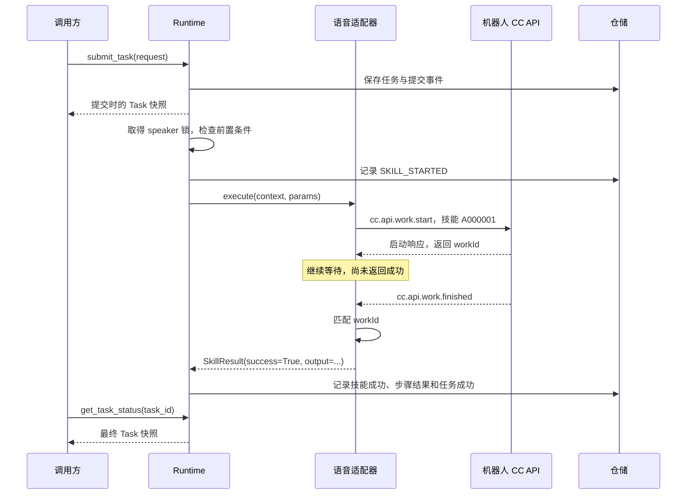
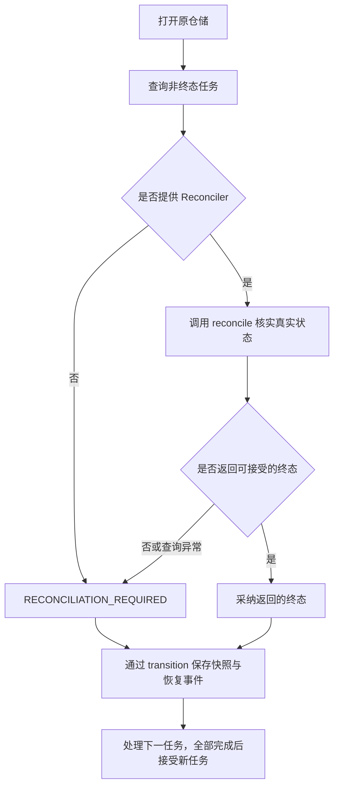

# 任务执行、结果获取、持久化与重启状态核对

本文以 CC API 语音播报为例，说明当前项目从提交任务到执行结束的完整流程，以及程序退出后能够和不能够恢复的内容。

依据：2026-11-03 的项目实现，包含同进程线程隔离。本文中的“当前行为”描述已有代码，“后续需要补齐”描述尚未实现的能力。

最重要的边界：**SQLite 保存记录；Reconciler 负责核实真实状态；当前 recovery 处理重启时的遗留记录，不会自动接管机器人上仍在执行的任务。**

## 1. 先区分几个概念

| 概念 | 在项目中代表什么 | 示例 |
| --- | --- | --- |
| 业务任务 `Task` | 上层提交的一项工作，可以包含多个步骤 | 先导航，再播报 |
| 技能调用 `SkillCall` | 任务中的一个步骤 | `audio.speak`，参数为 `message` |
| 执行协程 `asyncio.Task` | Python 中实际执行业务任务的异步对象 | `execution` |
| 任务状态 `TaskState` | 整个业务任务当前所处阶段 | `RUNNING`、`SUCCEEDED` |
| 事件 `Event` | 记录某一时刻发生了什么 | `SKILL_STARTED`、`TASK_SUCCEEDED` |
| 本地任务 ID `task.id` | 运行时生成的业务任务标识 | 查询状态、订阅事件时使用 |
| 机器人任务 ID `workId` | CC API 启动播报后返回的机器人任务标识 | 匹配 `cc.api.work.finished` |
| 幂等键 `idempotency_key` | 调用方为同一次业务请求指定的稳定标识 | `announcement-001` |

`task.id`、`workId` 和幂等键是三个不同概念，不能相互代替。

## 2. 各模块负责什么

| 模块 | 主要职责 |
| --- | --- |
| [sdk/embedded.py](../src/robot_agent_runtime/sdk/embedded.py) | `RobotRuntime`：供同进程调用方使用的接口 |
| [sdk/listeners.py](../src/robot_agent_runtime/sdk/listeners.py) | 统一注册事件与结果回调，内部按任务订阅和清理 |
| [core.py](../src/robot_agent_runtime/core.py) | 启动、关闭、提交、取消、查询等运行时操作 |
| [kernel_host.py](../src/robot_agent_runtime/kernel_host.py) | 托管独立内核线程，桥接 SDK/Server 请求和事件快照 |
| [isolation.py](../src/robot_agent_runtime/isolation.py) | 技能、仓储、状态源、对账与校验的外部线程、期限和取消确认 |
| [boundary.py](../src/robot_agent_runtime/boundary.py) | 在复制前限制快照体积和深度，净化外部结果与异常 |
| [execution_context.py](../src/robot_agent_runtime/execution_context.py) | 将控制操作的预留容量传递到端口线程 |
| [thread_runtime.py](../src/robot_agent_runtime/thread_runtime.py) | 区分取消请求和真实完成，限制在途调用并有限关闭 daemon 循环 |
| [policy.py](../src/robot_agent_runtime/policy.py) | 提交时检查技能、参数 Schema、权限及前置条件 |
| [executor.py](../src/robot_agent_runtime/executor.py) | 顺序执行各个技能步骤，处理超时、取消和结果 |
| [resources.py](../src/robot_agent_runtime/resources.py) | 按资源名协调独占使用 |
| [task_state.py](../src/robot_agent_runtime/task_state.py) | 管理本机执行记录，通过 `transition()` 统一更新任务状态 |
| [events.py](../src/robot_agent_runtime/events.py) | 历史事件回放与实时事件推送 |
| [adapters/cc_api.py](../src/robot_agent_runtime/adapters/cc_api.py) | 将 `audio.speak` 转成 CC API 请求，等待对应的完成事件 |
| [repository.py](../src/robot_agent_runtime/repository.py) | 用内存保存任务和事件 |
| [sqlite_repository.py](../src/robot_agent_runtime/sqlite_repository.py) | 用 SQLite 保存任务和事件 |
| [recovery.py](../src/robot_agent_runtime/recovery.py) | 启动时处理遗留的非终态任务 |
| [ports.py](../src/robot_agent_runtime/ports.py) 中的 `Reconciler` | 供适配器实现的任务真实状态核对接口 |

## 3. 一次正常语音播报的完整流程

### 3.1 启动与提交

当前 [cc_api_speech_demo.py](../examples/cc_api_speech_demo.py) 按以下顺序工作：

1. 应用初始化并连接 `ubt_robot.Api`。
2. `CcApiSpeechSkill.start()` 注册 finished、断连回调并订阅任务结束通知。
3. `RobotRuntime.start()` 启动仓储，先处理仓储中的遗留任务，再允许提交新任务。
4. 调用 `submit_task()` 提交 `audio.speak`。
5. 若提供了幂等键，先查询同一键对应的原任务；找到就返回原任务，不再次执行。
6. 新请求创建任务，完成校验后交给执行器。

提交示例，假设 `runtime` 已启动：

```python
from robot_agent_runtime.models import SkillCall, TaskRequest

task = await runtime.submit_task(
    TaskRequest(
        task_type="announcement",
        idempotency_key="announcement-001",
        steps=[
            SkillCall(
                skill="audio.speak",
                params={"message": "请到一号窗口办理"},
            ),
        ],
    )
)
```

`submit_task()` 返回提交时的任务快照，通常此时技能还没有执行完成。返回的 `task` 不会自动跟随后台任务更新。

`TaskRequest.timeout_s` 是从接受请求开始的总期限，包含准入校验、排队、资源等待和各步骤执行。
到期前尚未派发或确认动作已停止，任务以 `FAILED / TASK_TIMEOUT` 结束；无法确认停止则进入
`RECONCILIATION_REQUIRED` 并隔离资源。停止确认与持久化使用独立期限，不能为了赶期限而省略。

当前 demo 的 `speak()` 没有设置幂等键；上面的示例用于说明如何显式使用该能力。

### 3.2 任务状态与技能事件

一次成功的语音任务通常经历：

```text
CREATED → VALIDATING → QUEUED → RUNNING → WAITING → RUNNING → SUCCEEDED
```

| 状态变化 | 原因 |
| --- | --- |
| 创建为 `CREATED` | 收到新请求，建立任务记录 |
| `CREATED → VALIDATING` | 开始提交校验 |
| `VALIDATING → QUEUED` | 校验通过，准备执行 |
| `QUEUED → RUNNING` | 执行器开始处理任务 |
| `RUNNING → WAITING` | 准备取得技能需要的资源锁 |
| `WAITING → RUNNING` | 已取得资源锁，并通过启动前检查 |
| `RUNNING → SUCCEEDED` | 所有步骤成功，且没有已接受的取消请求 |

当前实现只要技能声明了资源，就先记录 `WAITING` 再申请锁，所以短暂出现 `WAITING` 不代表资源一定被其他任务占用。`QUEUED` 也不代表已有优先级调度器，当前实现随后直接创建执行协程。

`SKILL_STARTED` 和 `SKILL_SUCCEEDED` 是事件名，两者之间任务状态仍然为 `RUNNING`：

```text
事件                     任务状态
SKILL_STARTED            RUNNING
等待机器人完成            RUNNING
SKILL_SUCCEEDED          RUNNING
TASK_RESULT              RUNNING
TASK_SUCCEEDED           SUCCEEDED
```

多步骤任务在一个技能成功后继续执行下一步，全部步骤完成后才进入 `SUCCEEDED`。

### 3.3 CC API 调用与完成通知



`SKILL_STARTED` 表示运行时已准备调用技能，发出该事件时机器人尚未确认受理。因此，后面仍可能收到 `not_in_work_mode` 等拒绝响应，任务随即失败。

当前语音约定是：**收到匹配 `workId` 的 finished 即视为成功，暂不解析 finished 中的结束原因。** 因此外部停止或机器人执行失败如果也发送该事件，当前普通执行路径同样会视为成功。运行时主动取消则走取消流程。

启动响应中的 `workId` 只表示请求受理。`spoken=True` 是适配器依据上述约定生成的结果字段，不是额外的声音检测结果。

### 3.4 资源锁与前置条件

`resources={"speaker"}` 表示该技能需要独占扬声器。每个资源名一把锁；播报和音乐如果都声明 `speaker`，就需要依次执行。导航声明 `base`，可以与语音使用不同资源并行执行。

锁按每个步骤取得和释放。在播报等待 finished 期间，运行时一直持有 `speaker` 锁；正常退出时释放。若超过停止确认期仍不能确认退出，任务进入 `RECONCILIATION_REQUIRED`，该资源在当前运行时内继续隔离，其他等待者报告 `RESOURCE_QUARANTINED`。锁只在同一个 `RuntimeCore` 实例内共享，其他客户端直接控制机器人不受这把锁约束。

取得锁之后、发出 `SKILL_STARTED` 之前，执行器调用 `_require_preconditions()`：

```python
blocked = skill.definition.preconditions & await provider.unsatisfied()
```

没有注入状态提供器，或技能的前置条件为空时，跳过这一步检查。交集非空则失败，不等待条件恢复，也不调用技能。状态读取抛异常时不会放行。

当前 CC API 语音技能声明空前置条件，未接入工作模式检查；`not_in_work_mode` 由机器人端拒绝请求后返回。执行中条件变化的推送处理属于 `RuntimeCore` 的状态监听路径，不是这个函数持续轮询。

## 4. 执行登记与两层结束回调

提交校验完成后：

```python
execution = asyncio.create_task(self._executor.run(task))
self._state.register_execution(task.id, execution)
```

`register_execution()` 保存 `task_id → asyncio.Task` 的对应关系，并注册：

```python
execution.add_done_callback(
    lambda finished: self.execution_finished(task_id, finished)
)
```

运行时借助这份登记，在取消任务时等待对应执行结束，在关闭时取消并等待全部执行。

成功语音任务的两层回调依次发生：

```text
机器人 finished 通知
    ↓ SDK 调用
_on_finished() → _finished() → 唤醒等待中的 Future
    ↓
技能返回成功 → 执行器保存任务成功状态
    ↓
执行协程返回
    ↓ asyncio 调用
execution_finished() → 清理本机执行记录
```

`execution_finished()` 本身不把任务改成成功。它确认业务任务已进入终态，并且结束的协程正是当前登记的协程，才清理内存中的执行记录、取消信号、锁和序号等。

仓储中的任务和历史事件不会随这次内存清理被删除。协程异常退出也会触发完成回调，因此“协程结束”与“业务任务成功”必须分开判断。

## 5. 调用方如何取得结果

### 5.1 通过运行时接口

```python
task = await runtime.submit_task(request)

async for event in runtime.subscribe_task_events(task.id):
    print(event.event_type, event.data)

final = await runtime.get_task_status(task.id)
print(final.state)
print(final.result)
print(final.error)
```

正常情况下，事件订阅先回放历史再接收实时事件，收到终态事件后结束。`get_task_status()` 只查询当前快照，本身不会等待任务结束。

历史回放默认每页 128 条，每批之间让出内核循环；内存和 SQLite 仓储直接分页查询，旧仓储在
外部工作线程内裁页。普通请求、订阅和查询/取消/关闭分别限额，空闲订阅不能挤占控制容量。
实时队列和关闭后缓存默认各最多 1000 条，溢出报告 `EVENT_STREAM_OVERFLOW` 并保留最后交付水位。

成功的语音结果形如：

```json
{
  "steps": [
    {
      "step": 1,
      "skill": "audio.speak",
      "output": {
        "message": "请到一号窗口办理",
        "spoken": true,
        "work_id": "机器人返回的任务ID"
      }
    }
  ]
}
```

任务失败通过 `final.error.code`、`message`、`details` 获取原因。例如机器人拒绝启动时，`details["vendor_code"]` 保留厂商错误码。

### 5.2 通过当前 demo 的 speak()

在项目根目录的 Python 调用方中，假设 `api` 已连接：

```python
from examples.cc_api_speech_demo import speak

final = await speak(api, "你好")
print(final.id, final.state, final.result, final.error)
```

`speak()` 等待终态、清理运行时与适配器后返回 `Task`。任务执行失败或参数校验失败也返回任务快照；启动、清理异常仍会抛出，外层协程取消也不会变成普通返回值。SDK 连接由调用方管理。

函数通过统一注册的事件回调打印过程，结果回调把最终 Task 交给等待中的 Future，监听异常也通过 Future 传回调用方。返回的是运行时整理后的结果，当前不对外返回 CC API 的完整原始响应。命令行入口读取这个返回值，成功时打印结果，任务失败时抛异常退出。

### 5.3 await 与 asyncio.run()

| 写法 | 行为 |
| --- | --- |
| `speak(api, message)` | 只创建协程对象，不会执行播报 |
| `await speak(api, message)` | 在异步函数中执行并等待；等待时让出事件循环 |
| `asyncio.create_task(speak(api, message))` | 在运行中的事件循环里安排并发执行，之后可 await 取得结果 |
| `asyncio.run(speak(api, message))` | 同步入口创建事件循环，等待完成并返回结果，然后关闭事件循环 |

`asyncio.run()` 阻塞调用它的线程，但其内部的协程可以通过 await 协作执行。已有事件循环中的异步函数直接用 await，不能再嵌套调用 `asyncio.run()`。

## 6. InMemory 与 SQLite 各自保存什么


两种仓储都实现 `TaskRepository`，运行期间都可以保存、查询任务和事件。区别在于记录能否跨进程重启保留。

| 能力 | InMemory | 文件型 SQLite |
| --- | --- | --- |
| 当前进程查询任务和结果 | 支持 | 支持 |
| 重启后查询已完成任务 | 数据丢失 | 打开原数据库可查 |
| 重启后查看历史事件 | 数据丢失 | 保留 |
| 重启后发现遗留未完成任务 | 没有原记录 | 能找到原记录 |
| 跨重启根据幂等键找到原请求 | 不支持 | 支持 |
| 自动知道机器人真实执行结果 | 不支持 | 单靠 SQLite 也不支持 |

文件型 SQLite 用 `tasks` 保存最新任务快照，用 `events` 保存有序历史。使用 `:memory:` 的 SQLite 仍是内存数据库，不能跨连接关闭保留数据。

带事件的状态更新通过 `TaskStateStore.transition()`，由 SQLite 在同一事务内更新快照和追加事件；事务成功后才推送事件。仅更新快照的内部操作、最初创建任务是各自的仓储调用，不应理解成整个任务生命周期只有一个事务。

持久化的假设配置如下，`speech` 须已启动：

```python
from robot_agent_runtime.sdk import RobotRuntime
from robot_agent_runtime.sqlite_repository import SQLiteTaskRepository

runtime = RobotRuntime(
    SQLiteTaskRepository("/workspace/robot_core/tasks.db"),
    {"audio.speak": speech},
)
await runtime.start()
```

每次启动必须打开同一个数据库文件。当前 demo 仍然使用新的 `InMemoryTaskRepository`，没有应用上述替换。

SQLite 不保存活着的 asyncio 协程、锁或 SDK 连接，也不在后台监听机器人。程序退出后，数据库不会自行更新。

## 7. 两个重启场景：SQLite 的价值与局限

### 场景 A：成功结果已经写入，但调用方没有收到

```text
提交 announcement-001
    ↓
播报完成，SUCCEEDED 与结果已保存
    ↓
进程退出，调用方未收到结果
    ↓
重启后，用相同幂等键再次提交
```

- InMemory：原记录消失，新请求会再次执行。
- SQLite：根据幂等键找到原任务，直接返回已保存的成功状态和结果，不再播报。

这是当前已具备的能力。前提是结果已经提交到数据库、重启使用原数据库，而且调用方重试使用相同幂等键。

### 场景 B：数据库还是 RUNNING，机器人可能仍在播报

```text
任务保存为 RUNNING
    ↓
程序退出，机器人继续执行
    ↓
机器人完成并发送 finished，但原连接已断开
    ↓
SQLite 仍然记录 RUNNING
```

在当前没有 CC API Reconciler 的情况下，重启后会将任务改为 `RECONCILIATION_REQUIRED`。再次提交同一个幂等键，返回这个原任务，不重新执行，也不返回成功结果。

**这个场景里，SQLite 保留了“请求曾经发起过，结果需要核实”的证据，但没有解决机器人真实结果查询的问题。** InMemory 则连原请求记录也丢失，重复提交会被当成新请求。

这两种情况不能混为一谈。结果写库前退出的窗口仍然存在，本地幂等机制不等于机器人动作获得了“恰好执行一次”的保证。

当前相同幂等键命中后直接返回原任务，不校验两次请求参数是否一致。因此同一个键应只用于同一次业务请求。

## 8. recovery 与 Reconciler 的准确含义

### 8.1 当前 recovery：重启时核对遗留记录

`RuntimeCore.start()` 打开仓储后，查询全部非终态任务，包括 `CREATED`、`VALIDATING`、`QUEUED`、`RUNNING`、`WAITING`、`CANCELING`，逐个处理完毕才接受新任务。



若恢复结果的仓储写入失败，启动失败，不会带着尚未保存的恢复结果继续接收任务。

已经处于终态的任务不再核对，原状态和结果保留。恢复事件接着原事件序号递增。

### 8.2 Reconciler：由适配器实现的真实状态查询

接口为：

```python
class Reconciler(Protocol):
    async def reconcile(self, task: Task) -> TaskState | None: ...
```

它需要根据本地任务找到机器人侧对应的动作，再查询机器人。数据库保存的是“上次记录到什么状态”，Reconciler 需要提供来自机器人或其他权威来源的信息。

| reconcile() 的结果 | 当前 recovery 的处理 |
| --- | --- |
| `SUCCEEDED`、`FAILED`、`CANCELED` | 更新为对应终态，记录 `TASK_RECONCILED` |
| `UNKNOWN` | 采纳这个终态，保留结果未知的含义，不代表执行成功 |
| `None` 或非终态，例如 `RUNNING` | 改为 `RECONCILIATION_REQUIRED` |
| 没有 Reconciler，或查询抛普通异常 | 改为 `RECONCILIATION_REQUIRED` |

当前接口只返回状态，不能返回完整的步骤输出。对于参与恢复的任务，恢复逻辑会把快照中的 `result` 设为 `None`；已有历史事件仍保留。

### 8.3 当前不能做到的事情

- 恢复原来的 asyncio 协程或从中断位置继续执行。
- 自动补收原连接断开期间丢失的机器人通知。
- 自动重放尚未执行或执行一半的技能。
- 接管仍在机器人上执行的动作，并持续跟踪到最终完成。
- 自动实现 CC API 的状态或历史结果查询。

`RECONCILIATION_REQUIRED` 在当前状态模型中属于终态，下次启动不会再次自动核对。它表达“需要外部处理”，项目尚未提供专门的人工确认、再次核对或重新接管 API。

因此当前的 recovery 更准确的叫法是“重启状态核对与遗留记录处理”，不能当作完整的任务续执行能力。

## 9. 客户端退出、正常关闭与进程崩溃不同

| 情况 | 当前行为 |
| --- | --- |
| 远程客户端退出，Runtime 服务进程仍在 | 服务端继续执行、接收完成事件并保存结果；客户端之后可重新查询 |
| 调用 `runtime.close()` 正常关闭 | 请求取消，有限等待停止确认；无法确认的动作进入待对账，线程中在途代码可能继续 |
| Runtime 被强制终止、崩溃或断电 | 无法保证清理代码执行；机器人可能继续动作，仓储保留最后提交的记录 |

对于当前语音适配器，本地取消会停止指定 work，并等待匹配的 finished。适配器内部停止清理有 5 秒默认上限；运行时还受 `RuntimeOptions.cancel_grace_s` 约束，可能先进入待对账。需要完整等待硬件停止确认的部署须配置足够的确认期。停止失败或断连时不能将软件任务状态直接当作硬件已经停止的证明；适配器会拒绝后续播报。

声明不支持取消的真实调用不会被强制取消。支持取消的调用须正常成功返回或显式抛出
`TaskCancelled` 证明已停止，只有 `CancelledError` 仍属于停止不明。语音适配器关闭时先完成
回调解绑，再传播停止未确认错误；多项清理错误聚合上报。SDK 关闭先启动内核停止，异步监听
清理最多等待 `cancel_grace_s`，吞取消的监听不能阻止业务停止。

SDK 和服务端的内核循环独占一个线程；应用回调留在调用方，技能等外部实现由代理交给
固定的外部循环。即使外部 async 函数内部同步阻塞，也不占用内核循环。外部仓储超过
操作期限后停止后续访问，写入结果可能不确定，不能无条件重试。线程无法强制终止，
原生扩展持有 GIL 或系统资源耗尽也不在此隔离保证内。低层 `RuntimeCore` 单独调用不提供
托管边界；业务入口应使用 SDK 或 `RuntimeServer`。

如果希望调用方退出后仍能正常记录任务结果，应让 Runtime 常驻，通过 `RemoteRuntime` 提交和查询任务。这能处理客户端退出，但服务端自己崩溃时仍然需要真实状态核对。

当前 `robot-agent-runtime serve` 命令行入口固定组装模拟器。将 CC API 语音放入常驻服务，需要在组装入口注入真实适配器并管理 SDK 连接；当前语音 demo 本身不是常驻服务。

## 10. 真正恢复机器人任务还需要补齐什么

以下是后续实施方向，当前代码没有完成这些能力。

1. **保存本地任务与机器人动作的对应关系。** 至少关联本地任务、步骤、一次执行标识与机器人 `workId`。当前语音启动后只在内存里保存 workId，步骤成功后才将它放入结果；运行中崩溃时无法依靠数据库中的结果找到该 workId。
2. **确认机器人提供查询或补发能力。** 需要按 workId 或稳定关联标识查询当前状态、历史结果，或者可靠补发离线期间的事件。现有演示代码展示实时 finished，尚未确认这些查询能力。
3. **实现 CC API Reconciler。** 查询已经结束的动作，将权威结果转换成运行时状态。多步骤任务还需要明确整单状态如何从步骤结果得出，不能直接用一个步骤的完成代表整个任务成功。
4. **扩展“仍在执行”的处理。** 当前返回 RUNNING 会进入待确认终态。若要重新接管，需要重建监听与取消关系、恢复资源占用，并在完成后保存结果，且不能再次发送启动指令。
5. **处理发起指令与保存 workId 之间的中断窗口。** 仅在启动响应后保存 workId 仍然存在空档。需要结合启动前保存的关联标识及机器人侧查询或幂等能力处理，不能只靠本地 SQLite 事务保证机器人动作与数据库同时提交。
6. **支持恢复完整结果与再次核对。** 若上层需要步骤输出、错误详情，当前只返回 TaskState 的接口还不够；待确认任务的后续处理入口也需要设计。

如果机器人既不保存历史结果，也不支持事件补发，程序离线期间丢失的信息无法仅靠本地数据库还原，必须保留“结果未知”的状态。

## 11. 当前项目能力清单

| 能力 | 当前情况 |
| --- | --- |
| 正常连接时提交语音、等待匹配 finished、取得结果 | 已实现 |
| 语音参数校验、speaker 互斥、取消与超时处理 | 已实现 |
| SQLite 保存任务快照、事件和已取得的结果 | 已实现 |
| 相同幂等键返回原任务，不再次调度执行 | 已实现；demo 未传幂等键 |
| 重启发现非终态任务，并调用可选 Reconciler | 已实现 |
| 无法核实的任务标记为待确认 | 已实现 |
| CC API 启动时立即持久化 workId 关联 | 未实现 |
| CC API Reconciler 与历史结果查询 | 未实现，查询能力还需确认 |
| 重启后重新跟踪仍在机器人上执行的任务 | 未实现 |
| 保证机器人物理动作“恰好执行一次” | 当前不提供该保证 |

## 12. 运行与验证位置

项目使用保留的 `robot_core_ubuntu24` 容器，项目挂载到 `/workspace/robot_core`。所有验证在容器里进行，完成后保留容器。

```bash
docker start robot_core_ubuntu24
docker exec -it -w /workspace/robot_core robot_core_ubuntu24 bash -l
```

在容器里运行语音示例，连接参数使用机器人已授权的配置，Token 通过 `CC_API_TOKEN` 环境变量提供：

```bash
python3 examples/cc_api_speech_demo.py \
  --api-id YOUR_API_ID \
  --address ROBOT_IP:PORT \
  --message '你好，我是机器人'
```

自动测试不连接真实机器人：

```bash
python3 -m pytest -q
```

本文只整理当前实现与能力边界，没有切换 demo 的仓储，也没有新增机器人状态查询或任务接管功能。
